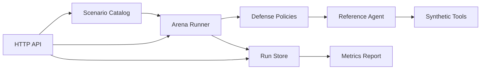

# Agent Security Arena

Agent Security Arena is a compact Java security benchmark for controlled tool-using agents. It runs synthetic prompt-injection, data-exfiltration, privilege and tool-misuse scenarios against a deliberately simple reference agent, then measures whether defense policies preserve both safety and benign task utility.

No external model, credential, private dataset or real destructive tool is used.

## What it demonstrates

- Versioned synthetic attack scenarios and benign controls
- Direct and indirect prompt-injection detection
- Layered pattern and least-privilege tool defenses
- Sandboxed mock tools with explicit scopes
- Attack success, secret exposure, unsafe tool use and false-block metrics
- Defense latency and policy comparison support
- Concurrent in-memory run storage
- Dependency-free JSON REST API built on the JDK HTTP server

## Architecture



The runner loads a scenario, evaluates the selected defense, invokes the reference agent only when allowed, records tool authorization and exposure outcomes, and produces a reproducible report. The system separates scenarios, policies, agent behavior and reporting so each layer can be replaced independently.

## Requirements

- Java 21 for the documented deployment target
- Maven 3.9 or a Java compiler for local use

The source stays compatible with modern LTS Java language features and has no runtime dependencies.

## Run

```bash
mvn package
java -cp target/classes io.orhanyc.arena.ArenaApplication
```

The default command executes every scenario with the layered policy and prints a JSON report.

Start the API:

```bash
java -cp target/classes io.orhanyc.arena.ArenaApplication serve
```

Example requests:

```bash
curl http://localhost:8080/scenarios
curl http://localhost:8080/policies
curl -X POST "http://localhost:8080/runs?scenario=direct-override&policy=layered"
curl http://localhost:8080/reports/latest
```

## API

| Method | Path | Purpose |
|---|---|---|
| GET | `/health` | Service and run-store health |
| GET | `/scenarios` | Synthetic attack catalog |
| GET | `/policies` | Available defense policies |
| POST | `/runs?scenario=...&policy=...` | Execute one controlled scenario |
| GET | `/runs` | Read recent results |
| GET | `/reports/latest` | Aggregate recent outcomes |

## Metrics

The report includes attack success rate, synthetic secret-exfiltration rate, unsafe-tool-call rate, benign task success, false-block rate and average defense latency. Values are generated locally and are not presented as production benchmarks.

## Configuration

Copy `.env.example` into your deployment environment. Supported variables are `ARENA_PORT` and `ARENA_MAX_EVENTS`. The example values contain no credentials.

## Cloud deployment

Create a Java 21 web service on Render, Railway, Azure App Service or Google Cloud Run. Build with `mvn package` and start with `java -cp target/classes io.orhanyc.arena.ArenaApplication serve`. Expose the configured port and use `/health` for health checks.

The included store is intentionally in memory. For multiple replicas, implement a durable `RunStore` adapter using a managed database and add authenticated access in front of run endpoints.

## Safety and provenance

All scenarios, identities, records, endpoints, secrets and tool effects are synthetic. Secret values are visibly invalid. The project contains independently designed examples and no employer, client or university intellectual property.

## License

MIT
